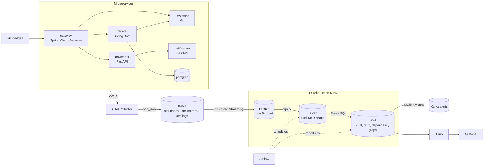

# tracelake

A real-time observability platform for microservices: it collects traces and metrics with OpenTelemetry, streams them through Kafka, stores them in a Hudi lakehouse, detects performance anomalies with Spark, and shows service health in Grafana.

## Why

When a request crosses five services and gets slow, the hard part is finding which service is responsible. Logs on each box tell part of the story. tracelake keeps every span, joins them into call paths, computes rate, errors and latency per service every minute, and flags the service whose behaviour changed. The goal is to answer "who slowed down, since when, and what calls it" from one dashboard.

## Architecture



More detail in [docs/architecture.md](docs/architecture.md).

## Features

- OpenTelemetry auto-instrumentation in Java, Python and Go services, configured only through env vars.
- One OTel Collector that exports traces, metrics and logs to Kafka as OTLP JSON.
- Bronze ingestion with Spark Structured Streaming, partitioned by date and hour, with checkpoints on MinIO.
- Silver span table in Apache Hudi (Merge on Read), keyed on `trace_id` + `span_id`, so late and duplicate spans are upserted.
- Gold tables: RED metrics per service per minute (p50, p95, p99), SLO burn, service dependency graph.
- Anomaly detection on RED metrics with Spark MLlib KMeans, alerts written back to Kafka.
- Airflow DAGs for reports, Hudi maintenance, model retraining and data quality.
- Grafana dashboards backed by Trino SQL over the Hudi tables.
- One `docker-compose.yml` with three profiles: `core`, `full`, `demo`.

## Prerequisites

- Docker Engine 24+ with Docker Compose v2.20+
- GNU Make
- RAM available to Docker:

| Profile | What runs | RAM |
|---|---|---|
| `core` | Kafka, MinIO, Spark master and worker | 8 GB |
| `full` | core + collector, 5 services, Postgres, Airflow, Trino, Grafana | 16 GB |
| `demo` | full + k6 load generator | 16 GB |

## Quick start

```
cp .env.example .env
make up          # core profile
make topics      # create Kafka topics
```

Then, for the whole stack with traffic:

```
make demo
make logs
```

Stop with `make down`. Remove all data with `make clean`.

## Service URLs

| Service | URL | Notes |
|---|---|---|
| Gateway (API entry) | http://localhost:8000 | `/api/catalog`, `/api/orders`, `/api/payments` |
| Grafana | http://localhost:3000 | login from `.env` |
| Airflow | http://localhost:8081 | login from `.env` |
| Trino | http://localhost:8082 | user `grafana`, no password |
| Spark master UI | http://localhost:8080 | |
| Spark worker UI | http://localhost:8083 | |
| MinIO console | http://localhost:9001 | login from `.env` |
| MinIO S3 API | http://localhost:9000 | |
| Kafka (host clients) | localhost:9094 | inside the network: `kafka:9092` |
| OTLP gRPC / HTTP | localhost:4317 / localhost:4318 | |

## Versions

| Component | Version |
|---|---|
| Apache Kafka | 3.9.1 (KRaft, no ZooKeeper) |
| Apache Spark | 3.5.5 (Scala 2.12, Java 17, Python 3) |
| Apache Hudi | 1.0.2, bundle `hudi-spark3.5-bundle_2.12` |
| hadoop-aws | 3.3.4 (matches the Hadoop client in Spark 3.5) |
| MinIO | `pgsty/minio` RELEASE.2026-08-04T00-00-00Z |
| OTel Collector contrib | 0.120.0 |
| Apache Airflow | 2.10.5 (Python 3.11, LocalExecutor) |
| Trino | 470 |
| Grafana | 11.5.2 with `trino-datasource` 1.0.11 |
| k6 | 0.57.0 |
| PostgreSQL | 16.4 |

The Hudi bundle is picked to match the Spark minor version (`spark3.5`) and Scala version (`2.12`). If you bump Spark, bump the bundle in [spark/common/spark_session.py](spark/common/spark_session.py) too. The official `minio/minio` images are no longer published on Docker Hub, so we use the community build from `pgsty`.

## Repo layout

```
.
├── docker-compose.yml     one file, three profiles
├── Makefile               up, up-full, demo, down, clean, topics, logs, ps, test, lint, seed
├── contracts/             Avro schemas for spans and metrics
├── docs/                  architecture and ADRs
├── services/              gateway, orders, payments, inventory, notification
├── otel/                  collector config and image
├── loadgen/               k6 scenarios, chaos notes
├── kafka/                 topic creation and sample data
├── lakehouse/             MinIO buckets, Trino catalog, Hudi table design
├── spark/                 streaming and batch jobs, shared session, tests
├── airflow/               DAGs and DAG import tests
├── grafana/               provisioning and dashboards
└── .github/               CI, templates, CODEOWNERS
```

## Roadmap

1. **Foundations**: repo, compose profiles, contracts, ADRs, CI.
2. **Walking skeleton**: services emit spans, collector to Kafka, Bronze ingest running.
3. **Core pipeline**: Silver Hudi spans, Gold RED metrics, Hive Metastore with Hudi hive sync, Trino and Grafana on top.
4. **Anomaly detection and SLOs**: KMeans on RED metrics, SLO burn rates, alerts topic.
5. **Hardening**: chaos tests with Toxiproxy, data quality checks, Hudi compaction and cleaning, schema evolution.
6. **v1.0**: documented install, stable dashboards, tagged release.

## Contributors

| Area | Handle |
|---|---|
| Services, OTel, load generation, Kafka | @member1 |
| Lakehouse, contracts | @member2 |
| Spark jobs | @member3 |
| Airflow, Grafana, CI | @member4 |

See [CONTRIBUTING.md](CONTRIBUTING.md).

## License

MIT. See [LICENSE](LICENSE).
