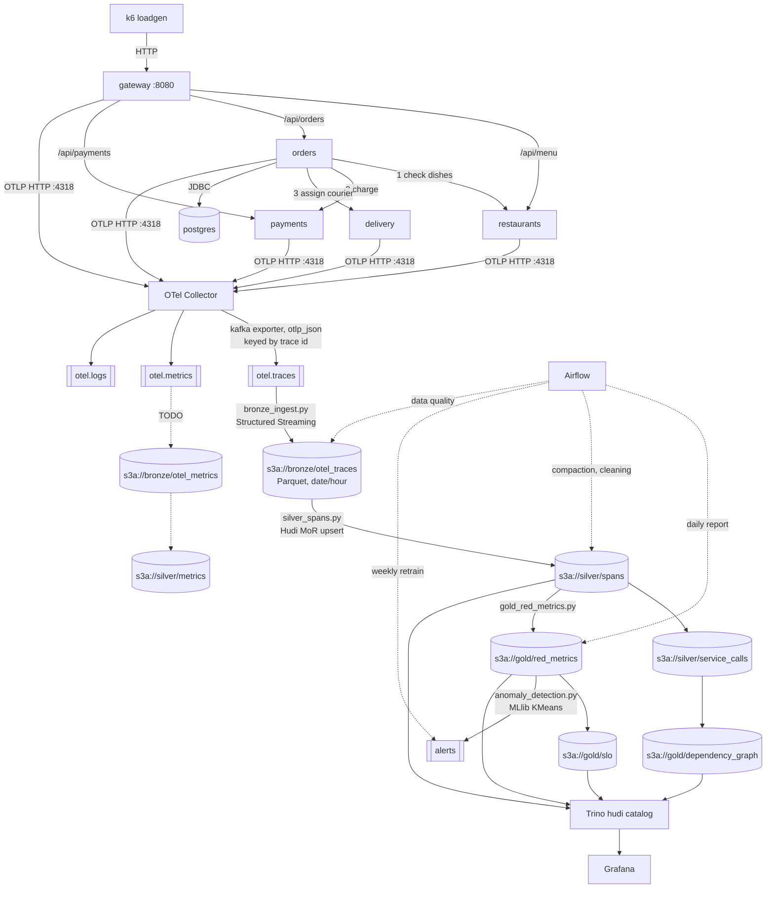

# Architecture

## Data flow



## One order, one trace

`POST /api/orders` enters the gateway and fans out from `orders`:

```
gateway      SERVER  POST orders
gateway      CLIENT  POST
orders       SERVER  POST /orders
orders       CLIENT  POST          -> restaurants  SERVER  POST /restaurants/{id}/check
orders       CLIENT  INSERT orders.food_orders
orders       CLIENT  POST          -> payments     SERVER  POST /payments
orders       CLIENT  POST          -> delivery     SERVER  POST /deliveries
orders       CLIENT  UPDATE orders.food_orders
```

This is a simplified view of a real trace: the agents also add `INTERNAL` spans for Spring Data, Hibernate and the ASGI send and receive steps.

The Java agent (gateway, orders), `otelhttp` (restaurants) and `opentelemetry-instrument` (payments, delivery) all use the W3C `traceparent` header (`OTEL_PROPAGATORS=tracecontext,baggage`), so every span shares one `trace_id`. The collector sets `partition_traces_by_id`, so all spans of a trace land in the same `otel.traces` partition. Silver keeps the span kind, which Gold uses to count only `SERVER` spans in RED metrics and to pair `CLIENT` and `SERVER` spans in the dependency graph.

## Layers

| Layer | Location | Format | Written by |
|---|---|---|---|
| Raw stream | Kafka `otel.*` | OTLP JSON | OTel Collector |
| Bronze | `s3a://bronze/` | Parquet, partitioned by `date`, `hour` | `bronze_ingest.py` |
| Silver | `s3a://silver/` | Hudi Merge on Read | `silver_spans.py` |
| Gold | `s3a://gold/` | Hudi Copy on Write | `gold_*.py` |
| Checkpoints | `s3a://checkpoints/` | Spark streaming state | all streaming jobs |

Bronze keeps the payload exactly as it arrived, plus Kafka metadata. Nothing is parsed there, so we can replay Silver at any time.

Silver flattens `resourceSpans[].scopeSpans[].spans[]` into one row per span matching [contracts/span.avsc](../contracts/span.avsc).

Gold holds small, query ready tables that Grafana reads through Trino.

## Runtime

Everything runs from [docker-compose.yml](../docker-compose.yml). Profiles:

- `core`: Kafka, MinIO (plus bucket init), Spark master and worker.
- `full`: core + collector, services, Postgres, Airflow, Trino, Grafana.
- `demo`: full + k6.

Spark jobs are submitted to `spark://spark-master:7077` from the master container. The shared builder in [spark/common/spark_session.py](../spark/common/spark_session.py) sets the Hudi, Kafka and S3A packages and MinIO endpoint.

## Decisions

See [adr/](adr/).
