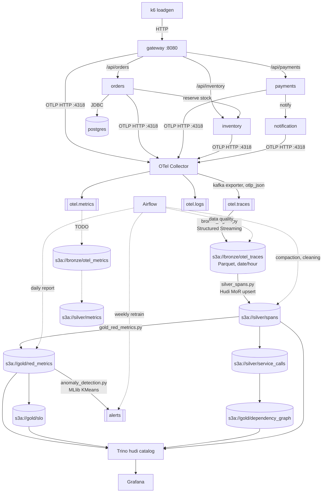

# Architecture

## Data flow

## Layers

| Layer | Location | Format | Written by |
|---|---|---|---|
| Raw stream | Kafka `otel.*` | OTLP JSON | OTel Collector |
| Bronze | `s3a://bronze/` | Parquet, partitioned by `date`, `hour` | `bronze_ingest.py` |
| Silver | `s3a://silver/` | Hudi Merge on Read | `silver_spans.py` |
| Gold | `s3a://gold/` | Hudi Copy on Write | `gold_*.py` |
| Checkpoints | `s3a://checkpoints/` | Spark streaming state | all streaming jobs |

Bronze keeps the payload exactly as it arrived, plus Kafka metadata. Nothing is parsed there, so we can replay Silver at any time.

Silver flattens `resourceSpans[].scopeSpans[].spans[]` into one row per span matching [contracts/span.avsc](../contracts/span.avsc).

Gold holds small, query ready tables that Grafana reads through Trino.

## Runtime

Everything runs from [docker-compose.yml](../docker-compose.yml). Profiles:

- `core`: Kafka, MinIO (plus bucket init), Spark master and worker.
- `full`: core + collector, services, Postgres, Airflow, Trino, Grafana.
- `demo`: full + k6.

Spark jobs are submitted to `spark://spark-master:7077` from the master container. The shared builder in [spark/common/spark_session.py](../spark/common/spark_session.py) sets the Hudi, Kafka and S3A packages and MinIO endpoint.

## Decisions

See [adr/](adr/).
